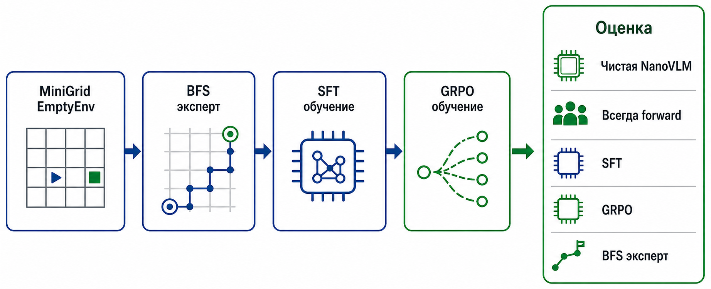
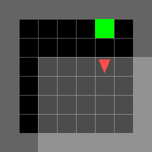
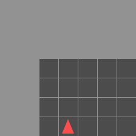
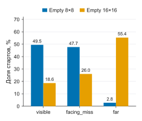
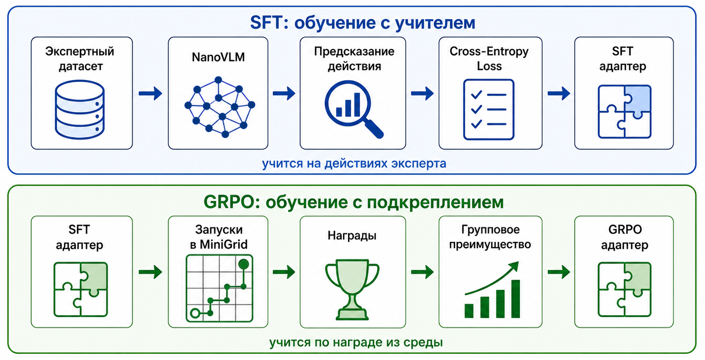
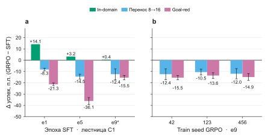
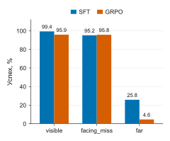
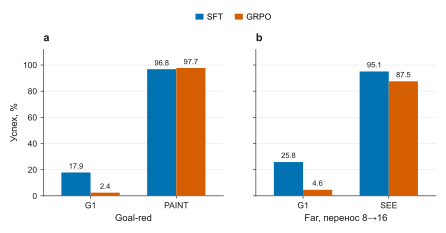
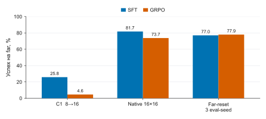
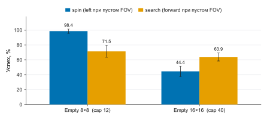

# MiniGrid Navigation NanoVLM (SFT + GRPO)


## Описание проекта

Компактная vision-language модель NanoVLM учится водить агента в MiniGrid Empty. Агент видит кусок карты 7×7 клеток картинкой RGB и выбирает одно действие: `left`, `right` или `forward`.

Сначала сеть списывает шаги у всевидящего BFS-эксперта (SFT). Потом поверх этого адаптера outcome-GRPO доучивает политику наградой за весь эпизод: дошёл до цели или нет.

**Что получилось.** На обучающей карте 8×8 с зелёной целью GRPO не хуже SFT. На тех же весах он хуже на двух проверках, которых в обучении почти не было: перенос на карту 16×16 и красная цель. Это не «GRPO плохой». На 8×8 награду можно взять, не умея того, что потом меряется на тесте: идти к зелёному пятну и крутиться, пока оно не появится в кадре.

Нового алгоритма нет. Вклад — отрицательный результат, два отдельных механизма и простой критерий, когда от SFT→GRPO ждать минус.

Статья и ВКР ещё не готовы. Этот README — текст проекта.

Канон цифр этой страницы: оценка `generate`, 250 эпизодов, горизонты **12** шагов на 8×8 и **40** на 16×16, длинный SFT (эпоха 9 на 8×8). Это не таблицы внизу про 3 эпохи SFT и не горизонты 16/38.

Общая схема pipeline:



## Оглавление

1. [Стенд](#стенд)
2. [Главный результат](#главный-результат)
3. [Два механизма](#два-механизма)
4. [Почему на переносе SFT выше](#почему-на-переносе-sft-выше)
5. [Критерий](#критерий)
6. [Чего этот результат не говорит](#чего-этот-результат-не-говорит)
7. [Запуск](#запуск)
8. [Линейка A в том же репозитории](#линейка-a-в-том-же-репозитории)

## Стенд

Стены по краю, внутри пусто, одна цветная клетка-цель. Робот не видит всю карту.

| Полный вид 8×8 | Вид агента |
|---|---|
|  |  |

Три типа старта, которыми режутся результаты:

| Старт | Что видит агент |
|---|---|
| `visible` | Цель уже в кадре |
| `facing_miss` | Цели в кадре нет, но 1–3 поворота на месте её показывают |
| `far` | Цели нет ни с одной стороны этой клетки. Нужно идти и искать |

На 8×8 `far` — около 3% стартов. На 16×16 — около 55%. Тот же робот, те же три действия, другой ответ на вопрос «цель рядом или далеко».



Модель — [NanoVLM v0.1](https://github.com/huggingface/nanoVLM/releases/tag/v0.1), около 222M параметров, дообучение LoRA. Формат входа:

```text
User: <image>
{prompt}
Assistant:
```

Промпт обучения просит дойти до зелёной клетки. Ответ — один токен с пробелом впереди: ` left`, ` right` или ` forward`. Без пробела это другой id токенизатора.

Два учителя:

1. **SFT.** Эксперт — BFS по полной позе (координаты, направление, где цель). Он видит то, чего нет на картинке. Сеть учится кросс-энтропией: на этом кадре правильный шаг — такой.
2. **GRPO.** Второй LoRA поверх SFT. С одной карты берётся группа из 16 попыток. Кто дошёл лучше среднего по группе, того действие становится чаще. Если все 16 кончились одинаково, градиента почти нет.

Оценка и обучение ходят одним путём `generate`: модель семплирует токен из всего словаря. Чужой токен сразу кончает эпизод, без подстановки `forward`. Для скоринга PPO/KL из тех же логитов берутся только три action-id. Клип PPO на этом корпусе не работает: один шаг обновления и dropout LoRA равный нулю дают отношение вероятностей 1. По факту это REINFORCE с групповым baseline и KL к SFT. GRPO всегда грузится вместе с родительским SFT.

Сравнение этапов:



## Главный результат

На одних и тех же весах знак «GRPO минус SFT» переворачивается, когда меняется тест, а не оптимизатор.



Канон — длинный SFT, эпоха 9, `generate`, 250 эпизодов × 3 seed. Δ = GRPO − SFT, в процентных пунктах.

| Где меряем | SFT | GRPO | Δ |
|---|---:|---:|---:|
| Empty 8×8, зелёная цель | 97.87% | 98.27% | **+0.40** |
| Те же веса, карта 16×16 | 57.47% | 45.07% | **−12.40** |
| Те же веса, цель красная | 17.87% | 2.40% | **−15.47** |

Строка 8×8 — среднее трёх train-seed GRPO. Две нижние строки — train seed 42, тот же знак у всех трёх eval-seed. По трём train-seed на эпохе 9 минус держится на обоих тестах: перенос **−11.64**, красная цель **−14.67**.

Минус есть уже после первой эпохи SFT, когда выигрыш GRPO на обучающей карте максимальный (**+14.1** п.п., а красная цель уже **−21.3**). На эпохах 1 и 5 знак минуса есть у всех трёх train-seed. Величины seed 123 и 456 с лестницей seed 42 не сравниваются: у них другой потолок шага на обучении.

Лучший SFT на обоих тестах — эпоха 5, не эпоха 9. Дальше кривые расходятся: перенос 59.87% → 57.47%, красная цель 40.27% → 17.87%. Падение красной цели несёт уже видимая красная клетка: успех на ней **48.64% → 21.32%** (около 122 таких стартов из 250).

Вывод: GRPO усиливает то, чем на обучении уже можно взять награду. На 8×8 это «иди к зелёному» и «крутись на пустом кадре». Навык, который нужен на большой карте и на другом цвете, в эту награду почти не входит.

## Два механизма

### Перенос: робот не начинает поиск

Дыра почти целиком на стартах `far`. Поворачиваться на месте умеют оба.

| Старт на переносе 8→16 | SFT | GRPO |
|---|---:|---:|
| `facing_miss` | ~96% | ~96% |
| `far` | **25.81%** | **4.61%** |



На неудачных эпизодах GRPO в 71–81% случаев крутится на месте. SFT — в 20–26%.

Проверка «может, разучился ходить». Оракул SEE сам доводит агента до кадра, где цель уже видна, дальше обычный `generate`. Far GRPO поднимается **4.61% → 87.54%**. Идти к увиденной цели он умеет. Сам пойти искать, пока цели нет ни в одном виде с места, не начинает. Это восстановление инициации, не починка поиска целиком.

Тот же SEE на train-seed 123 и 456: far 5.51% / 4.62% → 93.74% / 77.01%. Дыра не «не повезло с seed 42».



Почему так выходит на 8×8: в 300 группах обучения эпоха 9 страта `far` попалась **12 раз**. Поиск почти не входит в градиент по частоте. Из этих 12 групп градиент ещё есть у 10. Обнуляются 2.

Если учить сразу на карте 16×16, где `far` — больше половины стартов, пола 4.61% нет.

| Eval seed | Far SFT | Far GRPO | Δ |
|---:|---:|---:|---:|
| 42 | 81.69% | 73.71% | **−7.98** |
| 123 | 79.86% | 77.55% | **−2.31** |
| 456 | 69.47% | 72.26% | **+2.80** |

Δ на 42 — среднее трёх train-seed, и парный 95% интервал по тем же 142 стартам **[−15.26; −0.47]** целиком ниже нуля. На 123 и 456 интервалы **[−9.03; 4.63]** и **[−5.60; 11.45]** накрывают ноль: на 456 точка выше, уверенного плюса нет. Среднее SFT по трём seed (**77.01%**) из **73.71%** не вычитать: у GRPO другая ось, три обучения при одном eval-seed 42.



Вывод: GRPO стирает поиск там, где поиск не нужен, чтобы брать награду обучения. На native 16×16 катастрофы нет. Зарегистрированный минус около 8 п.п. — клетка eval-seed 42, не закон «GRPO всегда хуже на far».

### Красная цель: награда смотрит на зелёные пиксели

На обучении цель всегда зелёная. «Дойти до цели» и «дотронуться до зелёного» — одна и та же награда.

Проверка PAINT: те же красные раскладки, в тексте по-прежнему «red», клетку цели перед кадром перекрасили в зелёный. GRPO: **2.40% → 97.73%**. Отдельный прогон с красной картинкой и зелёным текстом даёт примерно то же, что красная картинка и красный текст. Shortcut — цвет пикселя, не слова миссии.

На train-seed 123 и 456 PAINT тоже поднимает красную цель к 98%.

Если в обучении подмешать красную цель, успех на красном тесте растёт до **54.40%**, а на зелёной обучающей карте падает до **94.40%**. Причинность карты обучения видна. Политика от этого не становится целой.

Вывод: цвет клетки здесь и есть цель. В постановках, где цвет карты — помеха при другой награде, тот же GRPO может обобщать лучше SFT. У нас он обобщает хуже, потому что shortcut входит в награду.

## Почему на переносе SFT выше

Эксперт видит скрытую цель. На 8×8 почти все пустые кадры — «цель рядом, повернись». Редкие дальние кадры он всё же идёт вперёд, и пошаговый SFT это немного запоминает. GRPO смотрит на успех всего эпизода при случайном старте: редкая ходьба почти не помогает взять награду, и политика заостряет кручение.

На 16×16 у эксперта наоборот: большая часть пустых кадров — `far`, и там он чаще шагает вперёд. Поэтому SFT, обученный сразу на 16×16, с самого начала видит ходьбу на пустом кадре. Перенос с 8×8 этот урок не получает.

Та же развилка видна без нейросети. Две зашитые политики на пустом кадре: крутиться или идти вперёд.

| Карта | Крутиться | Идти вперёд |
|---|---:|---:|
| 8×8 | ~98% | ~71% |
| 16×16 | ~44% | ~64% |



Интервалы этих двух политик не пересекаются. Успех GRPO на переносе (~45%) лежит рядом с крутилкой на 16×16 (~44%). По стратам это не одна политика: крутилка даёт 100% / 100% / 0%, GRPO — 95.88% / 95.82% / 4.61% (`visible` / `facing_miss` / `far`). Соседство суммарных процентов — компенсация. Красную цель эта картинка не объясняет: там нужен PAINT.

Вывод: остаток SFT на переносе — побочный эффект шпаргалки всевидящего эксперта, не аргумент «клонирование благороднее RL».

## Критерий

GRPO на тесте ожидается не ниже SFT, если без проверяемого навыка нельзя устойчиво брать награду обучения. Если навык эксперту изредка нужен, а для награды обучения бесполезен, ожидается минус.

Это эвристика со знаком, не теорема. Малая доля `far` на 8×8 (около 2.8% случайных стартов) показывает, что навык редко попадает в группу из 16 попыток. Порога «ниже 3% — будет минус» нет: нужен ещё остаток имитации и сдвиг теста.

| Работа | Можно ли взять награду обучения без тестового навыка? | Знак |
|---|---|---|
| Chu et al., цвет карт при награде «24» | Нет, цвет — помеха | RL выше SFT |
| Lu et al., ImageNet-R | Нет, награда — верный класс | RL выше SFT |
| Visionary-R1, сложный VQA | Да, текст лёгких вопросов достаточен | shortcut |
| Эта работа, красная цель | Да, достаточно зелёного пятна | GRPO ниже SFT |
| Эта работа, поиск 8→16 | Да, на 8×8 хватает кручения | GRPO ниже SFT |
| Эта работа, far на native 16×16 | Нет, дальние старты в обучении есть | не катастрофа 4.61% |

## Чего этот результат не говорит

- Нет нового алгоритма, большой модели и второго домена. Для диплома сюжета хватает. Перенос на Qwen2-VL или Habitat не измерен.
- SEE не «чинит поиск». Политика идёт, когда цель уже в кадре.
- 54.40% после смеси цветов — не «задача решена».
- 73.71% на native 16×16 — не «GRPO не хуже SFT». На eval-seed 42 он ниже, и этот минус не шум тех стартов. На seed 456 знак точки другой, интервал накрывает ноль.
- Клип PPO и полный категориальный KL в этот результат не входят. Цифры сняты тем пайплайном, который здесь описан.
- Старый прогон с жадным декодером и 4.4% успеха читал не последний токен. Исправный жадный декодер на тех же весах: SFT **98.27%**, GRPO **96.27%**. Это другое число, чем 98.27% у GRPO под `generate`. Канон страницы — `generate`.
- DoorKey в сюжет не входит: там SFT насыщается слишком рано, и это другой вопрос.

## Запуск

1. Клонируйте репозиторий и установите зависимости: `pip install -r requirements.txt`.
2. Скачайте [NanoVLM v0.1](https://github.com/huggingface/nanoVLM/releases/tag/v0.1) и положите папку в корень под именем `nanoVLM`.
3. Если `wandb` не нужен, добавьте `--no-wandb` к командам обучения.

Датасеты эксперта:

```powershell
python scripts/dataset_generation.py --env-size 8 --save-path datasets/dataset_8x8
python scripts/dataset_generation.py --env-size 16 --save-path datasets/dataset_16x16
```

Оценка канона эпохи 9. Горизонт передаётся явно: **12** на 8×8 и **40** на переносе. Существующие каталоги в `checkpoints/` не перезаписывать. Новое обучение — только в новый `--output-dir`.

```powershell
python scripts/test_models.py --env-size 8 --dataset-path datasets/dataset_8x8 --sft-adapter-path checkpoints/sft_adapter_8x8_bs32_e10/epoch-9 --grpo-adapter-path checkpoints/grpo_adapter_8x8_handoff_from_e10_e9/episode-100 --episodes 250 --max-steps 12

python scripts/test_models.py --env-size 16 --dataset-path datasets/dataset_16x16 --sft-adapter-path checkpoints/sft_adapter_8x8_bs32_e10/epoch-9 --grpo-adapter-path checkpoints/grpo_adapter_8x8_handoff_from_e10_e9/episode-100 --episodes 250 --max-steps 40 --val-split 0.01

python scripts/test_models.py --env-size 8 --dataset-path datasets/dataset_8x8 --sft-adapter-path checkpoints/sft_adapter_8x8_bs32_e10/epoch-9 --grpo-adapter-path checkpoints/grpo_adapter_8x8_handoff_from_e10_e9/episode-100 --episodes 250 --max-steps 12 --goal-color red --prompt-goal-color red
```

Флаги скриптов: `python scripts/<name>.py --help`.

```text
vlm-minigrid-rl/
├── checkpoints/          # LoRA; канон — sft_adapter_8x8_bs32_e10/epoch-9
├── datasets/             # экспертные датасеты 8x8 и 16x16
├── docs/figures/         # виды среды и схема pipeline
├── scripts/              # обучение, оценка и измерения
├── src/vlm_minigrid_rl/  # библиотека Empty и измерения
├── thesis/               # рисунки и сверка цифр
├── nanoVLM/              # внешний чекаут NanoVLM
└── README.md
```

## Линейка A в том же репозитории

Ниже — другая линейка: SFT на 3 эпохи, старый общий горизонт (8×8 считался на 12 шагах, 16×16 на 40, без отдельного потолка обучения). Её нельзя складывать с таблицей эпохи 9 выше. Код этих измерений в репозитории есть. DoorKey, rejuvenation и Phase 0 сюда не входят.

| Среда | SFT, 3 эпохи | GRPO | Δ |
|---|---:|---:|---:|
| Empty 8×8, mean 3 seed | 93.47% | 97.73% (`episode-75`) | +4.26 |
| Empty 16×16, mean 3 seed | 78.13% | 83.33% (`episode-100`) | +5.20 |

Вывод той линейки узкий: пока SFT ещё не упёрся в потолок, GRPO на родной карте добавляет несколько пунктов. После длинного SFT этот прирост на 8×8 сжимается до **+0.40** п.п., и главным результатом становится знак на двух тестах вне обучения.
